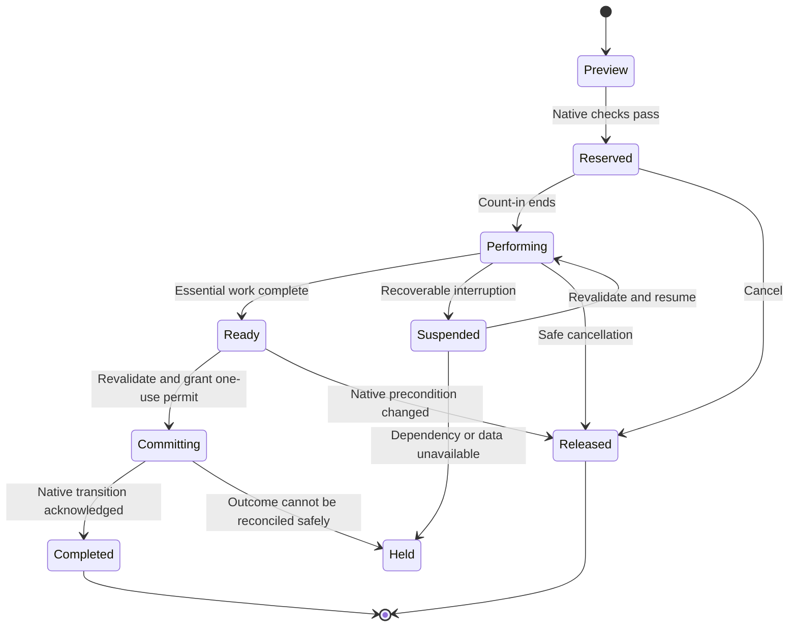

# Immersive Magic — Coding Agent Guidance

**Target:** Minecraft 1.20.1 · Forge 47.4.23 development baseline · Java 17  
**Proposed mod ID:** `immersive_magic` · **Proposed package:** `com.otectus.immersivemagic`  
**Prepared:** October 28, 2026  
**Deliverable:** A new Immersive-family addon covering Ars Nouveau, Iron's Spells 'n Spellbooks, and Ars 'n Spells through tactile, thematic interactions.

This is a design and implementation specification, grounded in source review. It is not an implemented mod or a claim of runtime compatibility. Existing behavior described below comes from the inspected versions; mini-games, new interfaces, configuration names, and architecture are proposals to implement. Source references and inspected revisions appear at the end.

## 1. Assignment and intended experience

Build **Immersive Magic** as the magic-workshop counterpart to Otectus's Immersive Smithing, Tanning, Enchanting, Jewelry, Apotheosis, and Brewing mods. A player should feel that they are inscribing a spell, aligning an apparatus, weaving a magical thread, or pressing a glyph into a plate. Each action needs an obvious target, readable material feedback, and a satisfying finish.

Use the existing mods' workstations, recipes, spell systems, progression, and items. Add an interactive performance layer at the operation that changes state. Do not create parallel versions of every station or replace the three mods with a new magic system.

The complete scope includes **every registered workstation operation and every functional system** in the supported versions. The coverage tables below establish the minimum. A registry and interaction audit must expand them where the installed artifacts contain additional surfaces. An initial vertical slice is a milestone, not completion of this assignment.

Use three treatments, chosen according to the activity:

| Treatment | Where it belongs | Required result |
| --- | --- | --- |
| **Perform** | Manual crafting, inscription, upgrades, conversions, and starting substantial rituals | A short thematic game integrated with the real operation; completing it invokes the authoritative native action. |
| **Attune** | Linking, programming, commissioning magical infrastructure, assigning helpers | A brief spatial or timing interaction when the player changes the setup; normal operation then continues automatically. |
| **Live feedback / preserve** | Combat casting, ongoing resource production, transport, passive bonuses, storage browsing, world generation, decorative placement | Preserve native mechanics and add useful feedback where appropriate. No recurring interruption or compulsory combat mini-game. |

This distinction is part of full coverage. Opening a chest, casting a movement spell during combat, collecting every bottle, or waiting for a familiar to act must not become a repeated crafting challenge.

### 1.1 Family conventions to carry forward

| Existing project | Relevant inspected pattern | Apply it here |
| --- | --- | --- |
| Immersive Smithing | Distinct physical stages, clear timed targets, server sessions, persistent maker information | Give each station a recognizable action and show the workpiece changing. |
| Immersive Tanning | Skill concentrated at meaningful moments; passive work batched; recoverable materials | Avoid mandatory babysitting and destructive failure. |
| Immersive Enchanting | Rune presentation, input timing, accessible shapes, optional adapters, authoritative outcomes | Reuse suitable concepts and permitted assets, but do not turn every station into its four-lane rhythm game. |
| Immersive Jewelry | Separate cutting and setting simulations, including removal and maintenance modes | Model the actual operation, including reverse operations, instead of reskinning a generic progress bar. |
| Immersive Apotheosis | An interactive workbench over native stations; upstream owns affixes, recipes, and limits | Wrap upstream decisions and outputs without inventing more powerful ones. |
| Immersive Brewing | Distinct reagent/reaction/distillation interactions; sealed resumable work; native recipe outcomes | Make interruption safe and keep fluids, effects, and batch identity exact. |

Inspect the current repositories and any applicable `AGENTS.md` before implementation. Reuse established input, rendering, configuration, synchronization, and test conventions when they fit. Do not introduce a mandatory shared Immersive library as a prerequisite for this mod. Copying family code or art requires compliance with that repository's license; using another mod's runtime API is preferable to copying its implementation.

### 1.2 Initial supported version matrix

| Component | Initial development / validation target | Important qualification |
| --- | --- | --- |
| Minecraft / Forge / Java | 1.20.1 / 47.4.23 / 17 | Matches the inspected Enchanting toolchain and exceeds the inspected Iron's 47.4.0 floor. Reconcile transitive dependencies before locking the build. |
| Ars Nouveau | 4.12.7 | Inspected `1.20` source declares this version. Do not use current `main` APIs from another Minecraft release. |
| Iron's Spells 'n Spellbooks | `1.20.1-3.16.3`; additionally test `1.20.1-3.15.0` | The inspected 3.16.3 source branch is named **`not-1.20.1`**. `1.20.1-legacy` declares 3.4.0.11 and is not an interchangeable API target. |
| Ars 'n Spells | 3.4.0, `otectus/ars-n-spells` | Includes the Glyph Press and imported Iron's glyphs, in addition to the Spell Loom and rituals. |
| Other Immersive mods | Inspected versions, then the actual pack versions | Each integration is optional and independently tested. |

Pin exact dependency artifacts, hashes, mappings, and runtime profiles in the implementation's compatibility document. ANS's broad admitted version ranges do not establish that Immersive Magic supports that entire range. A second Minecraft version or NeoForge build is separate work, not an implied deliverable.

Support Ars-only, Iron's-only, Ars plus Iron's without ANS, Ars plus ANS without Iron's, and all three together. Respect ANS's own required Ars dependency. The core must also load safely with no target mods; explain that no integrations are active.

## 2. Product rules

1. **Native rules remain authoritative.** Preserve ingredients, catalysts, quantities, remainders, XP units, Source costs, spell levels, rarity, slot limits, knowledge requirements, recipe conditions, and server disables.
2. **One action has one owner.** Immersive Magic owns the performance session; the selected integration owns the underlying operation. A completed game must never trigger both a custom craft and the original craft.
3. **Source and player mana are different resources.** A crafting Source cost does not become a player-mana cost. ANS owns its mana conversion, LP/aura substitution, discounts, scaling, cooldowns, and casting charges.
4. **Do not generate better spells through skill.** A perfect scroll remains the selected native spell at its native level. Do not add glyphs, increase affinity, award spell knowledge, change a school, create extra slots, or reroll offers as a reward.
5. **Preserve unrelated data.** Names, enchantments, durability, Curios state, attributes, capabilities, family craftsmanship, ANS sidecars, and native spell containers survive unless the native operation intentionally changes them.
6. **No new mandatory consumables for existing operations.** A quill, lens, needle, tuning fork, or stamp may be a rendered contextual tool. Requiring a new tool item or ingredient is a separate, explicitly configured progression change.
7. **No recurring maintenance tax.** A completed link or calibrated machine stays configured until its meaningful native setup changes. It does not decay simply because time passed or a player logged out.
8. **Errors are correctable.** Default performance failure does not destroy rare materials or apply permanent penalties. Incomplete essential work cannot produce an output. Native destructive operations and native random losses still behave normally after the player knowingly commits to them.
9. **Automation retains native capability.** Player-started jobs use the game. Existing fully automated production continues under native rules by default, with no craftsmanship award. Machinery must not gain player-only capabilities through a fake player.
10. **Performance must be brief.** Target 5–12 seconds for common crafting, 12–20 seconds for complex work, and 2–5 seconds for small changes or link attunement. Exceptional ceremonies may reach 30 seconds through explicit profiles. Existing shorter operations, especially the Glyph Press, should use their own processing window rather than adding another full timer.

### 2.1 Quality and outcome policy

Implement one consistent default: **successful performance produces the exact native result**. Skill determines how efficiently and cleanly the player completes the physical work. Mistakes introduce a small corrective action or reduce the displayed workmanship grade; they do not silently weaken the spell or remove its effects.

For each profile, define normalized measures such as alignment, pressure control, valid path coverage, and timing. Calculate `Q = round(100 × weighted_mean(measures))`, with nonnegative documented weights totaling 1. Essential stages are separate boolean requirements: a high average cannot compensate for never sealing the glyph.

Use family-style descriptive grades: Crude 0–34, Standard 35–69, Fine 70–89, Masterwork 90–100. Persist maker/grade only on suitable durable finished items using an Immersive Magic-owned record. Avoid tagging ordinary ingredients, glyph knowledge, every potion bottle, or other stackable intermediates just to display a grade. Show those results in the session summary instead. Cosmetic preferences must not change the authoritative output.

Do not add default damage, mana, Source, XP, cooldown, yield, or rarity bonuses. Do not add a new leveling system that competes with ANS affinity. If optional mechanical quality rewards are implemented later, give them their own bounded, disabled-by-default adapter policy and balance tests; they are not required for the initial complete release.

Cancelling before native commitment returns/releases the same inputs and reservations. After a native operation has irreversibly started, keep its actual state and native cancellation rules; never refund costs while its effects continue. Native randomness, such as scroll recycling, is rolled once by its owner and cannot be previewed and rerolled by reopening a game.

## 3. Required coverage: Ars Nouveau

Names below are functional groups, not permission to assume every similarly named class is registered. Resolve exact IDs from the supported artifact. Source starting points: [S7], [S8], [S9].

| ID | Station or system | Required operations | Immersive treatment |
| --- | --- | --- | --- |
| A01 | Scribe's Table — `ars_nouveau:scribes_table` | All native glyph recipes, ingredient delivery, selection, XP payment/refund, result delivery, nearby inventory collection | **Sigil Inscription.** Guide a quill along 3–6 meaningful strokes, controlling ink with hold/release. Ingredient collection stays native. Distinguish glyph creation from learning the resulting glyph. |
| A02 | Scribe's Table — inscription | Every admitted `IScribeable` operation, including native spell-bearing carriers; preserve active spell, cosmetics, and source/target rules | **Sigil Inscription**, with a short copying/sealing variant. Audit each implementation of `IScribeable`; do not assume all carriers consume their source. |
| A03 | Imbuement Chamber — `imbuement_chamber` | All imbuement recipes, base conversion and pedestal-assisted recipes, native Source acceleration and passive processing | **Source Tuning.** Align concentric bands and hold a flow within a wide marked range during an attended job. Leave unattended native processing available. Do not make Source mandatory for a recipe that works without it. |
| A04 | Enchanting Apparatus + Arcane Core + Arcane Pedestals | General apparatus crafting, every native/addon `IEnchantingRecipe`, consumed and nonconsumed inputs, Source, remainders | **Constellation Assembly.** The actual loaded pedestals become nodes; connect 3–6 representative channels and seal the reagent. Presentation order does not turn a shapeless recipe into an ordered recipe. |
| A05 | Apparatus special operations | Enchantment application/upgrades, reactive enchantments, spell writing, armor upgrades and other special recipe subclasses | Profile the same apparatus with **Binding**, **Sigil Inscription**, or **Thread Weaving**. Use `enchantment`, `reactive_enchantment`, `spell_write`, and `armor_upgrade` semantics; preserve copied spells, armor XP/tiers, and existing enchantments. |
| A06 | Alteration Table — `alteration_table` | Inserting/removing supported armor, installing and removing threads/perks, native tier and slot checks | **Thread Weaving / Unpicking.** Three visible tension releases for a changed thread. Preserve native removal order, returned threads, legal slots, and perk data. Inspect `IPerkHolder` behavior rather than assuming every supported item is a vanilla armor class. |
| A07 | Ritual Brazier and Brazier Relay | Tablet insertion, augment offerings, activation, ongoing/one-shot rituals, cancellation, relay-triggered routes | **Ritual Conducting** for player activation. Cover all registered rituals and their augment rules. Relay/automated activation remains native unless a pack explicitly chooses a stricter policy. Do not demand repeated games during a long ritual. |
| A08 | Potion Melder — `potion_melder` | Input/output jar links, valid merging, Source expenditure, quantities, output capacity, ongoing cycles | **Confluence Mixing** for an attended merge or first setup. The native merge computes effects, strengths, and amounts. Existing links continue operating; an arbitrary slider must not choose new potion ratios or effects. |
| A09 | Potion Jar and Potion Diffuser | Fill/drain/storage, bottle and flask transfers, diffuser configuration and operation | Quick **Flow Attunement** for a changed diffuser setup; clear level/effect visualization for transfers. Routine filling and draining are immediate. Preserve custom potion data and native dosage. |
| A10 | Wixie Cauldron | Teaching/changing a crafting or brewing task, ingredient fetching, native output and automation | **Recipe Rehearsal**, a short sequence drawn from the actual recipe, when the player teaches a new task. Ongoing Wixie production needs no player performance. |
| A11 | Spell turrets, runes, prisms | Basic, enchanted, rotating, timer variants; spell installation/removal, aiming, prism/void-prism configuration and triggers | **Trajectory Attunement** against a harmless visual preview. Preserve stored spells, redstone behavior, native casting cost and permissions; do not execute a damaging practice spell. |
| A12 | Source Jars, including creative jars | Storage, extraction, transport, range/capacity feedback | Render understandable flow and current state. Optional network attunement belongs to configuring links, not every transfer. Never convert creative Source into a new survival reward. |
| A13 | All five native Sourcelinks | Agronomic, Alchemical, Vitalic, Mycelial, Volcanic generation conditions and outputs | A distinct **Source Tuning** demonstration during optional commissioning: growth, alchemy, life, decay, heat. Preserve actual triggers, rates, resource consumption and automation; no periodic tune-up requirement. |
| A14 | Source relay family | Normal relay, splitter, collector, deposit, warp, native ranges and supported endpoints | **Link Attunement** when establishing/changing a connection. Show real endpoints, direction and validity; the puzzle cannot create connections the native wand rejects. |
| A15 | Item Detector, Spell Sensor, Redstone Relay | Filter/spell/direction settings and native signal behavior | A brief **Signal Alignment** confirmation for configuration changes; live signal indicators afterwards. Preserve redstone timing and avoid polling the whole network every frame. |
| A16 | Storage and crafting infrastructure | Storage Lectern, Bookwyrm/crafting lectern, Repository, Archwood Chest, associated links and recipes | **Link Attunement** for changed bindings and recipe teaching. Preserve inventory browsing, search, extraction and bulk transfers without games. Never take custody of an entire remote storage network for one craft. |
| A17 | Magical helpers and homes | Starbuncle tasks, Drygmy Stone, Whirlisprig Flower, Wixie, Bookwyrm, summoning beds and associated native tools | **Bond/Task Attunement** only at summoning or assignment. Map resource/output destinations visibly. Helpers then perform their native work, with no bonus loot or bypass of habitat requirements. |
| A18 | Scryer's Oculus / Scryer's Crystal | Linking, selection, viewing and permitted remote interactions | **Lens Alignment** on a new link; preserve ordinary subsequent viewing. Do not load arbitrary distant chunks or grant remote interaction beyond the native system. |
| A19 | Warp/portal infrastructure | Ritual of Warping, portals and native destination/link items | **Gate Alignment** at creation or destination change. Portal travel remains immediate and uses native validity, dimension and access checks. |
| A20 | Familiars and native Binding ritual | Capture/binding prerequisites, Bound Scripts, familiar unlocks, summon/dismiss and native bonuses | **Bond Attunement** at the relevant binding/unlock event. Re-summoning a known familiar stays quick. Do not confuse this ritual with ANS Spellbook Binding. |
| A21 | Spellbook authoring and glyph knowledge | Spell editor, forms/effects/augments, glyph learning, caster tomes, book tiers, names/colors/sounds, bookmarks and spell selection | Keep the native editor and knowledge rules. Offer **practice inscription** and a harmless spell-flow visualization; saving a rearranged spell or switching slots does not force a craft game. |
| A22 | Magic equipment and ordinary crafting routes | Spellbook upgrade recipe, casting tools/foci, armor, threads, charms, potions/flasks and their native recipes | Cover existing recipes through their real station adapters. For ordinary crafting/smithing, use explicit operation profiles and the family ownership rules in §8; never synthesize a cheaper apparatus recipe. |
| A23 | Spell effects and in-world transformations | All registered glyphs, spell-driven crush/conversion/budding/dispel/summon/scry recipes, item/entity/block transformations | Native live execution, optionally with clearer preparation/target cues. Every spell remains usable; no mini-game per projectile, block broken, crop grown, or automation cast. |
| A24 | Remaining functional/environmental blocks and world content | Mob Jars, magical light, mage blocks, weave blocks, plants/archwood, habitat interactions, decorative blocks, mobs, loot and exploration | Preserve original behavior. Give configurable devices a short attunement where useful; record ordinary building, ecology, loot and world generation explicitly as preserved coverage. |

### 3.1 Ritual coverage must be registry-driven

Inventory every native and installed-addon ritual, not just the popular ones. The inspected native source includes daylight/weather changes; harvest, growth, forest and biome work; digging and disintegration; healing, flight and gravity; animal summoning/breeding; mob capture and familiar binding; scrying and warping; awakening, raid and Wilden summoning; and spawn suppression.

Group their games by what the player does: align celestial phases, trace a target boundary, synchronize growth pulses, establish a binding, or open a gate. Those visual motifs do not alter ritual targets, radius, duration, augmented ingredients, spawn tables, or permissions. Name exact registered ritual IDs in the implementation manifest. A destructive ritual needs the same intentional native activation; a practice demonstration must never activate it.

## 4. Required coverage: Iron's Spells 'n Spellbooks

Use the inspected 3.16.3 implementation as the primary behavioral reference and test the separate 3.15.0 profile. The upstream website is helpful for orientation but may describe older mechanisms. Source starting points: [S10], [S11], [S12], [S13].

| ID | Station or system | Required operations and constraints | Immersive treatment |
| --- | --- | --- | --- |
| I01 | Scroll Forge — `irons_spellbooks:scroll_forge` | Native spell selection and craftability, school focus, paper, ink, rarity-to-level result, all actual consumed inputs | **Scroll Forging:** align a school focus, feed ink into the selected sigil, press its seal. The inspected menu consumes a focus as well as ink and paper; do not assume it is a reusable tool. |
| I02 | Inscription Table — `inscription_table` | Insert/replace eligible spells, choose a slot, extract removable native spells, preserve locked slots, equipped-book behavior and original return location | **Binding / Unbinding** with a short page-and-seal interaction. Selection/browsing is immediate. Retain `InscribeSpellEvent` and all native checks. ANS carriers route to the ANS-aware adapter. |
| I03 | Arcane Anvil: scroll level upgrade | Scroll plus appropriate ink, native next-rarity check, maximum level and configuration | **Arcane Annealing.** Set the rune and release three controlled pulses. The inspected branch uses ink, despite old comments/guides describing two-scroll merging. |
| I04 | Arcane Anvil: unique-item spell improvement | Native `UniqueItem` branch, matching spell, higher scroll level, locked spell slot | **Seal Reinforcement.** Preserve the item's identity and exact slot; no arbitrary spell replacement. |
| I05 | Arcane Anvil: weapon/item imbuement | Native eligibility, spell-container behavior, selected/available slot and replacement semantics | **Channel Etching.** Trace the existing item's channel and seat the scroll seal. Display any native overwrite before commitment. |
| I06 | Arcane Anvil: upgrade orbs | Every registered orb type and valid equipment category, current upgrade counts and limits | **Orb Seating.** Balance the orb's contact points and close the binding. Preserve attribute slot assignments and addon orb data. |
| I07 | Arcane Anvil: Shriving Stone | Native stripping behavior, retained data and returned upgrade containers/byproducts | **Unbinding.** Lift the relevant seals in a short reverse sequence. Invoke the native result and additional-drop behavior exactly once; do not broadly clear NBT. |
| I08 | Arcane Anvil: spell-slot upgrades | Every admitted slot-upgrade item, native book eligibility and item-specific cap | **Page Stitching.** Seat and bind a new page. Do not increase capacity beyond the native one-slot result or make ANS proxy capacity unlimited. |
| I09 | Arcane Anvil: Affinity Ring attunement | Correct ring and scroll, exact spell identity and native consumption | **Resonant Attunement.** Match a pulse and seal the ring. Keep spell affinity distinct from ANS's per-school progression. |
| I10 | Alchemist Cauldron — brewing | Native brewing fallback plus datapack cauldron recipes: potions, elixirs, ink upgrades, soaking/transmutation and all byproducts | **Confluence Mixing.** Tend a visible reaction and release at its actual endpoint. Handle the current fluid representation; do not hardcode the older four-output-slot model from a guide. |
| I11 | Alchemist Cauldron — scroll recycling | Water/scroll conditions, native random success chance, resulting ink, consumption even on a native failed recycle | **Essence Separation.** Performance completes the manual separation; the native RNG then resolves once. Explain the chance before starting and never make a perfect game guarantee a successful recycle. |
| I12 | Alchemist Cauldron — transfer and blood | Fill/empty recipes, bottles/buckets, fluid capabilities, mixed storage, entity-driven blood generation and exclusion tags | Physical levels and clear transfer feedback. Routine transfer and existing blood collection stay native; the game must not create blood from a dummy target or bypass entity conditions. |
| I13 | Remaining registered functional blocks | Pedestal, portal frames/pocket-dimension infrastructure, vaults, braziers, blood-cauldron block, statues and other interactables | Audit actual registered and obtainable behavior. Use **Gate/Seal Attunement** for genuine player setup/unlock actions; preserve offerings, keys, cooldowns, rewards and world predicates. Decorative/legacy blocks are classified, not invented into new stations. |
| I14 | Magic gear and normal recipes | Books, armor, weapons, inks, foci, upgrade ingredients, crafting and smithing transforms | Native recipes plus explicit magical finishing profiles where appropriate. Coordinate with Smithing, Tanning and Jewelry; one output must not require two competing overlays on the same commit. |
| I15 | Casting and spell management | All installed spells/schools, scroll use, instant/charged/channelled casts, spell wheel, quick selection, imbued weapons, cooldowns and targeting | Optional nonblocking charge/aim/release cues and a safe practice mode. Do not change combat pacing, mana cost, damage, learning gates, or cancel semantics. |
| I16 | Progression and world gameplay | Learned/locked spells, discovery, mobs/bosses, structures, quests, loot, merchants, dimension and portal progression | Preserve native gates and content; contextual journal/tutorial feedback. A mini-game never grants a boss reward or a restricted spell simply for being completed. |

### 4.1 Required Arcane Anvil operation dispatch

Treat the seven distinct branches in I03–I09 as seven operations. Dispatch using the upstream result/eligibility logic, not an item-name heuristic. The current menu's `createResult()` and `onTake()` are separate concerns: a preview is not ownership of an item, and taking a result consumes inputs and may emit extra drops. Do not allow shift-click or number-key pickup to skip the game.

Do not silently apply old 3.4.x rules to the 3.15/3.16 adapters. If both APIs differ, maintain small version-specific adapters and parity fixtures.

## 5. Required coverage: Ars 'n Spells

Use **Otectus's** `ars-n-spells` 3.4.0 implementation. This is a substantial bridge with its own transactions and progression, not merely a mana-bar compatibility shim. Source starting points: [S14]–[S18].

| ID | System | Required behavior | Immersive treatment |
| --- | --- | --- | --- |
| N01 | Glyph Press — `ars_n_spells:glyph_press` | Genuine filled Iron's scroll → exact spell-and-level Ars glyph; plate, catalyst and Source terms; knowledge checks, tier, disabled spells, output capacity | **Glyph Embossing:** align the die, hold pressure inside the target band, then release/seal. Use the Press's native job and processing window. Do not add a second cost, XP requirement, new glyph variant or random failure. |
| N02 | Glyph Press restrictions and lifecycle | Refuse blank/malformed/multispell scrolls, ANS carriers and proxies, invalid levels and unknown required knowledge; honor loaded-jar lookup, buffer and reservations | Present each native refusal before gameplay. Keep hopper directions, player-only start, input locks, cancellation, save/load and data-reload behavior. The adapter must coexist with the existing job instead of layering a second craft on it. |
| N03 | Spell Loom — `ars_n_spells:spell_loom` | Export a valid Ars spell from an admitted source to a supported blank target; preserve source-consumption policy and one-unit semantics | **Spell Interlacing:** interweave representative form/effect/augment strands from the selected spell, then seal. The Loom exports an existing authored spell; it must not reorder its glyphs as a puzzle reward. |
| N04 | Spell Loom conversion | Explicit conversion of an already-filled target where the installed native operation supports it | Keep the native destructive confirmation and show the spell being replaced. Perform only after that explicit choice. A preview or ordinary Inscribe action must never blank a filled scroll. |
| N05 | Spell Loom school and cosmetics | Name, icon, background; Automatic/chosen school; applying school changes to an existing carrier | Cosmetic browsing stays instant. A school change may use a 2–3 second **School Attunement**, with no new material cost. Preserve the server toggle, valid registry choices, semantic school behavior and missing-addon fallback. Background/icon never set mechanics. |
| N06 | ANS carrier at Iron's Inscription Table | Bind exported Ars spell through native ANS checks and append logic, alongside ordinary Iron's spells | ANS-aware **Page Binding**, with a single owner for the operation. Preserve name/icon/background/school, semantic duplicate detection, native wheel proxy allocation and capacity. |
| N07 | Spellbook Binding ritual | The ANS ritual on Ars's Brazier; strict dropped-item inputs, radius, native duration and consumption | **Ritual Conducting + Page Binding** as one short performance, not two consecutive games. This is `ars_n_spells:spellbook_binding`, not Ars's familiar Binding ritual. |
| N08 | Spell Transcription ritual | Supported source plus blank target; exact ambiguity/blacklist checks, consumed source, cross-cast data and native timing | **Seal Transfer.** Show the selected source and target; preserve exact entity identity and inventory counts throughout. Do not accidentally replace its consumption policy with the Loom's reusable-source policy. |
| N09 | Spell Uninscription ritual | Strip ANS-owned inscriptions and associated native proxies; preserve unrelated native spells and item data; retain no-Iron's cleanup | **Unweaving.** Warn that the inspected implementation removes all ANS entries from the selected item. It is not native scroll extraction and must not be implemented as one-entry removal without an explicit upstream feature change. |
| N10 | Mana Infusion ritual | Native one-shot recipient selection, configured amount and active-pool routing | **Pulse Conducting** on activation. Delegate the grant to the ritual once; a performance score never adds another mana payment or refund. |
| N11 | Mana Well ritual | Native area recipients, duration/rate, active-pool routing and ongoing ticks | **Well Attunement** once on activation, then native ongoing operation with readable radius/state cues. No game each tick or each new player entering range. |
| N12 | Imported Iron's glyphs | Catalog availability, per-level knowledge, permitted forms/augments, emission/session limits, native charge/channel handling and per-spell cooldowns | Registry-driven glyph presentation and practice. Preserve the native cost/cast pipeline, rejected non-player casters, and dormant glyph recovery. Do not generate the imported glyph catalog again inside Immersive Magic. |
| N13 | Mana/scaling/progression bridge | All five mana modes, conversion and regen, gear/Curios/enchantments, potions, Source Jar synergy, resonance, per-school affinity/progression, category and proxy cooldowns | Read-only feedback from the bridge. ANS remains the sole owner of these calculations. Practice grants no mana, affinity, progression, LP/aura effects, or cooldown resets. |
| N14 | Other integrations and routes | Covenant LP/aura/discount paths, school mapping/overrides, addon glyph restrictions, commands, School Journal, compatibility screens, missing-dependency behavior | Preserve and test. Operator commands may remain an explicit privileged bypass; ordinary player/network routes may not accidentally bypass enforced sessions. Keep every native server disable authoritative. |

### 5.1 ANS-specific invariants

- Keep `arsnspells:cross_spells` intact through Loom → carrier → binding → save/load → native wheel → cast. The namespace in this stored key differs from the registry mod ID; do not rename it.
- The inspected bridge uses a finite native proxy pool (`ars_cross_1` through `ars_cross_8`). Query its actual capacity and checks; do not hardcode an unlimited extension or allocate a proxy twice.
- Cosmetic differences do not make duplicate spells mechanically distinct. Preserve ANS's own duplicate identity, including its school treatment.
- Ordinary Iron's extraction is not a supported way to extract a bound Ars proxy. Preserve the appropriate ANS uninscription path.
- School changes, glyph substitutions, invalid sources, data reloads and missing mods invalidate a stale performance plan before commit.
- The inspected Glyph Press reserves its own Source and locks its own inputs. Its block-break rule drops inputs once and loses stored Source; do not restore an old buffer snapshot into a replacement block.
- ANS already has request guards, inventory revisions, planners and transaction-oriented code. Integrate with those paths where available; do not create a competing cost or inscription implementation.

## 6. Mini-game specifications

Share rendering and simulation primitives, but give each process a different player action. The names below are proposed Immersive Magic profile names, not existing upstream APIs.

| Game | Visible task and controls | Success and correction | Typical use / target time |
| --- | --- | --- | --- |
| **Sigil Inscription** | A quill follows a visible glyph contour. Hold the primary action to ink a segment; release at a marked junction. Optional pointer guidance; keyboard mode advances the same path automatically. | Cover required strokes without excessive bleed. A missed junction highlights only the segment that needs repair. Do not require handwriting recognition or memorization. | Scribe's Table, copying, scroll sigils; 6–12 s. |
| **Source Tuning** | Select a ring, turn it with pointer or left/right, hold to channel when its notch aligns. Source visibly follows the aligned path. | All required paths align and the marked channel fills. Misalignment slows/reverses local progress; it never drains extra actual Source. | Imbuement, sourcelinks; 5–10 s attended segment. |
| **Constellation Assembly** | Actual pedestal items appear around the real reagent. Connect highlighted compatible nodes and close the center seal. | Complete a small connection plan. Invalid paths glow and release harmlessly. Never add an item-position requirement absent from the recipe. | Apparatus; 8–16 s. |
| **Thread Weaving / Page Binding** | A needle or luminous thread advances across three seams. Hold to tension; release in each broad marked band. | Three completed joins. A weak join gets one visible repair. Unpicking reverses the action and shows what will be returned. | Alteration, inscriptions, book slots; 3–10 s. |
| **Arcane Annealing / Channel Etching** | Warm a visible magical seal with a held action, then press/trace 2–4 anchors at the indicated intensity. | Each anchor reaches its marked depth/charge. Excess pressure makes that anchor need a brief correction. No extra durability damage. | Arcane Anvil; 7–14 s. |
| **Confluence Mixing / Essence Separation** | Follow a visible circulation direction, hold/release to maintain flow, then choose the marked finish moment. Separation uses a moving boundary between ink/essence and residue. | Complete the native reaction's stages. Material properties determine the pattern; the UI cannot alter the chosen recipe or RNG chance. | Cauldrons, melder; 6–15 s per attended operation/batch. |
| **Ritual Conducting** | Two to four runic sectors respond to the actual ritual theme. Hold the central focus and release each pulse when it reaches the matching sector. | Close the activation circuit once. Small errors expose a repair sector; closing the UI before activation does not start the ritual invisibly. | Brazier ritual starts; 4–12 s, fit shorter native rituals. |
| **Link / Lens / Gate Attunement** | Source and destination appear as named anchors. Align the indicated path or focal plane; confirm one stable pulse. | Native endpoints validate and the connection is committed. Invalid range/permission is a refusal, not a harder puzzle. | Infrastructure and helpers; 2–5 s. |
| **Glyph Embossing** | Align the stamp to the actual glyph plate, hold its pressure in a marked band while it engraves, release at the seal mark. | Native Press job is permitted to finish only when required work is done; existing Source/time/input conditions also remain required. | Glyph Press; fit native 5/7/10 s defaults, or configured duration. |
| **Spell Interlacing** | A compact diagram shows form, effect and augment groups from the existing spell. Guide luminous strands through 3–5 marked crossings and bind the export seal. | Strands reproduce the original spell exactly. Repair a crossed strand locally. Long spells increase pattern variety within caps, not one action per glyph. | Spell Loom; 7–15 s. |

### 6.1 Shared controls and presentation

- Primary action: mouse button or rebindable keyboard equivalent. Secondary action exists only when it adds a meaningful tool function. Avoid unrelated key chords and rapid clicking.
- Show the relevant item/block prominently, the next action in one short sentence, and the current cost/result nearby. Use existing item rendering rather than baked copies of dependency textures.
- Show shape plus color plus text for important cues. Support keyboard-only operation, toggle alternatives to holds, generous timing assistance, reduced motion, scalable UI, high contrast and captions.
- Client preferences may request assistance; the server decides its allowed range. Motor-accessible alternatives must preserve the same recipe and outcome. Do not penalize them with worse items.
- Count in briefly; auto-advance between stages. Show one compact result panel with action, output, grade, costs and any native random outcome. Offer a ready-to-repeat operation when legal.
- Screens do not pause multiplayer. Do not immobilize the player or hide danger behind an opaque fullscreen effect. Damage, escape, closing or changing location must use the declared safe interruption path.
- A practice session uses the same patterns but an isolated simulation: no native cast, world edits, resource consumption, output, advancement, affinity or progression.
- World observers see coarse progress and appropriate sound/particles. They do not receive unrestricted inventory contents or private spell data.

### 6.2 Complexity and batching

Use native recipe complexity, legal spell tier, or number of meaningful components to select a bounded profile. Do not scale duration directly with the total number of spells in a book or the size of a 777-glyph catalog. Show at most 3–6 simultaneous meaningful targets.

For batching, retain each native unit's real costs, remainders and randomized resolution. One performance may service a bounded native batch only if the adapter can prove equivalence. A batch of ten recycled scrolls still receives ten native resolutions, not one favorable roll multiplied by ten. No time-based duplicate reward farming, free focus reuse, or negative resource rounding.

## 7. Implementation architecture

### 7.1 Separate the framework from each optional integration

Use a compact internal framework with independently loaded integration packages:

```text
com.otectus.immersivemagic
  core/          Operation identity, immutable plans, resource claims, outcomes
  session/       Server lifecycle, locks, interruption and persistence
  minigame/      Deterministic simulations and profile codecs
  network/       Admission, inputs, synchronization, result notifications
  data/          Reloadable profiles, coverage manifest and exclusions
  client/        Screens, overlays, input, presentation and accessibility
  compat/ars/    Ars Nouveau station and system adapters
  compat/irons/  Iron's station and system adapters
  compat/ans/    ANS planners, jobs, rituals and binding routes
  compat/family/ Immersive station ownership and permitted API reuse
```

The core must not reference optional-mod classes in eagerly loaded fields, method signatures, annotations, serializers or static initializers. Instantiate adapters only after their required mod/version checks. Client classes must not be loaded on a dedicated server. Use the target's real mod ID and declared version metadata, not its display name.

Prefer public APIs and cancellable server events. A client screen overlay alone is insufficient. Where no usable pre-commit hook exists, implement a narrowly scoped, version-checked mixin/accessor, or a small documented upstream extension in the user's ANS project if needed. Keep any such dependency explicit; do not claim an API exists merely because it would be convenient. Avoid replacing whole native tick or menu classes.

### 7.2 Adapter contract

Implement the following responsibilities; the names are proposed internal interfaces:

```java
interface MagicOperationAdapter {
    // Read-only inspection; no XP drain, recipe roll, item mutation, or cast.
    Inspection inspect(ServerOperationContext context);

    // Validate admission and claim only resources this operation really owns.
    Admission begin(ServerOperationContext context, OperationSelection selection);

    // Recheck native validity, versions, ownership and resource identity.
    Validation validate(PreparedOperation operation);

    // Invoke the native transition once, under a scoped internal permit.
    CommitResult commit(PreparedOperation operation, PerformanceResult performance);

    // Release a reservation or hand back control without undoing native effects.
    InterruptionResult interrupt(PreparedOperation operation, InterruptionReason reason);
}
```

Define an explicit adapter capability for **immediate commit**, **existing native job**, or **native ongoing effect**. They have different interruption semantics and must not share a naive rollback implementation.

Each admitted `PreparedOperation` must identify:

- Operation ID, adapter version, recipe/selection identity, data generation and applicable configuration revision.
- Player, dimension, normalized master block position or held-item identity, menu identity where applicable, and the exact station instance/generation.
- Input stacks with complete relevant data, real slot/entity identities, native Source/fluid/XP requirements, remainders, output capacity, and any retained source/catalyst.
- Native job ID or selected offer when one already exists. Snapshot hidden randomness without exposing it; never reroll a native selected outcome for a better performance.
- Session nonce, sequence number, simulation seed, server start time, current stage and completion eligibility.
- Authoritative resource ownership and permitted interruption behavior. A copied preview stack is never an owned output.

Use each target's own planner/matcher/result builder. Custom recipe subclasses can have custom matching and output behavior; do not flatten them to ingredient lists. An inspection method with side effects is not safe merely because its name sounds like a preview.

### 7.3 Lifecycle and commit boundary

The normal session states are:



Do not force every native operation through every state. For example, the Glyph Press already persists a native job and handles cancellation; its adapter should gate that job's successful finish rather than create a second stored inventory.

At commitment, on the server thread, revalidate the whole native operation, check output capacity, and execute its authoritative transition once. Gate all pickup/click/packet paths that can cause that transition. A scoped one-use internal permit prevents the commit from recursively opening another performance game. It must not become a general bypass flag left enabled on a player.

Preserve native hook order, cancellation events, recipe advancement/stat effects, output remainders, and intentional extra drops. Failed validation moves nothing. If an upstream operation cannot be safely deferred at the current hook, move the integration point earlier; do not copy the world state and try to undo arbitrary side effects afterwards.

### 7.4 Resource custody and native early consumption

**Scribe's Table:** The inspected `ScribesTile.setRecipe()` charges XP points before the later crafting output, and the tile tracks consumed ingredients/refunds. Integrate before that charge, or explicitly track the existing native reservation. Never charge XP twice or refund levels where the recipe spent points. Normalize the multi-block's master tile and prevent starting separate sessions through different parts.

**Enchanting Apparatus:** Native `attemptCraft()` can take Source before its later result is produced. Gate before native start or cooperate with its already-started state. Track pedestal remainders and lock/validate every participating pedestal, not only the center block. Do not drain Source once for a game and again for the native craft.

**Glyph Press:** Its own saved job, input locks, buffer and reserved Source are authoritative. Add a performance condition through a narrow integration. Completing the game must not call a second conversion routine, shorten the configured native processing minimum, or cause a canceled native job to finish. No real player means no admission past its learning check.

**ANS rituals:** Transcription/binding/uninscription read dropped entities with strict ambiguity checks. Capture the chosen entity UUIDs and counts, prevent or detect merging, despawn, movement, pickup and competing ritual use, and revalidate the native radius. Do not silently search for substitute items at completion. If temporary custody is necessary, use one explicit escrow and ensure the native resolver consumes that same custody rather than also scanning duplicate world entities.

**Menus and held/equipped items:** Block result pickup, quick move, hotbar/number swaps, offhand changes, drops and capability extraction as appropriate. Preserve the original Curios return destination of an equipped book; closing a performance must not create a duplicate equipped and inventory book.

**Fluids and network inventories:** Use native handlers, simulated capacity checks and exact fluid/NBT identity. Do not lock a whole remote storage system. Reserve the minimal participants or invalidate the plan if they change. Prevent capability automation from extracting a reserved input through an unguarded side.

### 7.5 Interruption and persistence

Declare one tested policy per adapter:

| Situation | Required behavior |
| --- | --- |
| Cancel before native mutation | Release claims; keep exact inputs and native resources. No output. |
| Close screen, walk away, disconnect, die, change dimension | Suspend safely where the native job supports it; otherwise cancel before native mutation. Expose the result to the player after reconnect if needed. |
| Native ritual already running | Let its actual native lifecycle govern. Do not refund its tablet/Source while continuing its world effect. |
| Chunk unload / clean server stop | Persist only serializable identities and owned state; never retain a live player/menu reference. Resume only after revalidation. |
| Station broken, exploded, or replaced | One native drop/cancel path; never both drop the original inputs and manufacture an output. Identify block replacement even at the same coordinates. |
| Data or configuration reload | Validate the complete new data set first. Invalidate/cancel affected plans safely; do not silently reprice a running operation. Preserve the old valid data if the reload is invalid. |
| Dependency or recipe missing on load | Hold recoverable owned state and explain what is missing. Do not wipe unrelated stacks or substitute a random recipe. |
| Abrupt process termination during commitment | Reconcile using persisted operation identity and native state; if outcome is uncertain, hold it for recovery rather than automatically reissuing items or refunds. Test and document the actual crash-consistency limit. |

Minecraft does not provide a general transaction across arbitrary mod inventories and independently saved chunks. Do not claim generic crash-proof atomicity. Choose a defensible custody model per adapter, save phase/receipt markers with the authoritative owner where possible, and never recreate both pre-commit inputs and post-commit output from competing snapshots.

### 7.6 Server-authoritative input

Clients send bounded **input**, never a trusted score, output stack, resource refund, learned spell, or completion assertion. A start request identifies an operation and native selection; the server resolves everything else.

Input packets include protocol version, session nonce, monotonically increasing sequence, relevant stage and bounded pointer/control samples. Validate sender, live session, menu/station, dimension, reach, ownership, allowed controls and rate. Reject duplicate, stale, oversized, out-of-order and impossible-transition inputs without mutating inventory.

Use a fixed-step server simulation with client prediction for display. Timing assistance and any latency compensation are bounded by server policy; an arbitrary client timestamp cannot extend a session or award perfect timing. Do not require a 20 TPS server to judge sub-tick mouse precision it cannot establish fairly. Preserve playability under measured latency/jitter and server lag; use wider spatial/hold bands when appropriate.

Send progress corrections and final results reliably. World particles can be throttled. Cap concurrent sessions, simulation steps, targets, serialized state and packet samples. Do not scan all loaded block entities every tick or force-load chunks to maintain a session.

## 8. Integration ownership and family compatibility

Resolve the owner by **operation**, not merely by block namespace:

| Operation | Owner when the relevant mods coexist |
| --- | --- |
| Native vanilla enchanting offer | Immersive Enchanting, if active; Magic does not install another ritual over it. |
| Apotheosis reforge, salvage, socket/cut | Immersive Apotheosis, if active. |
| Base metal equipment manufacture | Immersive Smithing where its existing recipe policy applies. |
| Base leather manufacture and stitching | Immersive Tanning where its policy applies. |
| Base jewelry creation / ordinary gem work | Immersive Jewelry and its Apotheosis bridge as currently defined. |
| Ars apparatus enchantment or Iron's Arcane Anvil operation | Immersive Magic, preserving metadata and using any applicable family APIs. |
| Iron's Inscription Table with an ANS carrier | One ANS-aware Magic adapter; ordinary Iron's and ANS handlers must not both bind it. |
| Iron's cauldron / Ars potion systems with Immersive Brewing | Magic owns these native station interactions; Brewing owns its workshop. Reuse permitted presentation/simulation code without replacing one native recipe source with another. |

A metal staff can legitimately be forged in Smithing and later magically imbued in Magic: those are different operations. It must not play two games for the same output-take event. Preserve all existing maker marks and quality records as distinct properties; never collapse craftsmanship, enchantments, affixes, gems and magical binding into one number.

At startup, record which adapter owns each supported operation. Duplicate owners should produce an actionable diagnostic and a deterministic resolution. Unknown third-party handlers should retain native operation rather than be silently intercepted with incomplete semantics. The release coverage report must identify any such unsupported interaction instead of calling it complete.

Use JEI integration to expose native recipes, station context and the performed step. Keep recipe transfer operating as item staging, not a completion bypass. Add Jade/The One Probe support where available for job state, missing requirements, ownership and safe resume/cancel guidance. Do not make either viewer a dependency.

## 9. Data-driven coverage and configuration

### 9.1 Coverage manifest

Create `docs/coverage.md` and a machine-readable `docs/coverage.json` from the pinned runtime. Include:

- Loaded mod versions and hashes; active and dormant integrations.
- Registered functional blocks/block entities, menus, recipe types/serializers, actual recipes, spells/schools/glyphs, rituals, special item-use handlers and native automation routes.
- One record per operation: exact identifier, native entry/commit points, source file, chosen treatment, adapter/profile, costs/ownership, manual and automated entry routes, tests and status.
- Explicit `performed`, `attuned`, `native_preserved`, `unavailable_in_this_version`, or `unsupported` status with a reason. `Unsupported` is a release gap, not a synonym for preserved.

Combine runtime enumeration with source inspection. Registries alone will not reveal hardcoded branches such as Shriving Stone use, result-slot extraction, native mana modes or special item interactions. Conversely, a class present in a source tree is not proof that its block is registered or obtainable.

Every loaded recipe/glyph/ritual must resolve to a tested generic behavior or an explicit exception. Future addon content can inherit safe profiles through the native interfaces. A data profile can select a known adapter; it cannot teach an unknown native operation how to transact safely.

### 9.2 Profile schema

Implement versioned JSON profiles under:

`data/<namespace>/immersive_magic/operation_profiles/<name>.json`

Example **proposed schema**, not an existing Ars/ANS format:

```json
{
  "schema_version": 1,
  "priority": 100,
  "adapter": "immersive_magic:ars_scribe",
  "operation": "immersive_magic:ars/glyph_craft",
  "selector": {
    "blocks": ["ars_nouveau:scribes_table"],
    "recipe_types": ["ars_nouveau:glyph"]
  },
  "treatment": "perform",
  "game": {
    "type": "immersive_magic:sigil_inscription",
    "min_actions": 3,
    "max_actions": 6,
    "target_duration_seconds": 8,
    "max_duration_seconds": 20,
    "timing_assist_allowed": true
  },
  "outcome": {
    "policy": "native_exact",
    "persistent_grade": false
  },
  "presentation": {
    "theme": "immersive_magic:ars_source",
    "instruction_key": "immersive_magic.action.inscribe_glyph"
  }
}
```

Validate the schema, selector types, durations/action bounds, known adapter/game IDs, and localizable presentation keys. Use registry IDs/tags, not English labels. All selector dimensions must match; specify list matching and inheritance precisely. Suggested precedence: exact operation/recipe override, exact item/block override, tag/type profile, namespace fallback, generic adapter fallback; resolve ties by priority then resource ID and expose the resolution in diagnostics.

An absent optional mod should not break datapack loading. Unknown available content needs an explained native fallback; a malformed profile must never corrupt costs or prevent the whole server from loading. Apply a reload as a validated snapshot and invalidate changed plans by generation.

Profiles control the performance, not upstream recipe economics. Pack authors change native recipes and ANS Press terms in their existing formats. Read the resulting native plan; do not duplicate those numbers into Magic profiles.

### 9.3 Server and client settings

Use Forge server configuration and sync authoritative values. Suggested filename: `immersive_magic-server.toml`. Document its actual path and any family-wide/global configuration convention deliberately adopted; do not label a per-world Forge SERVER config as global. Keep visual preferences in `immersive_magic-client.toml`.

| Setting group | Required controls / default policy |
| --- | --- |
| Integrations | Separate Ars, Iron's and ANS toggles; only activate when their actual dependencies are present. |
| Operations | Per-operation and per-station enable/disable; recipe/item/tag exclusions; clear native fallback. |
| Manual behavior | Performed crafting enabled; routine transfer and browsing immediate; setup attunements brief. |
| Automation | Native processing preserved by default; optional strict policy must state which routes it changes and how existing jobs survive. No fake-player knowledge bypass. |
| Difficulty | Bounded duration, action count and control bands; predictable tiers. |
| Accessibility | Server-approved assistance and untimed alternatives; client motion, contrast, scale, sound and hold/toggle preferences. |
| Outcomes | Native exact output; nondestructive performance mistakes; no automatic mechanical bonuses. |
| Multiplayer | Reach, one active operator per contested operation, packet/session limits, interruption rules and operator recovery tools. |
| Debugging | Off by default; structured refusal codes, active adapter and profile selection, lifecycle evidence without dumping private inventories. |

Add permission-checked commands such as `/immersivemagic integrations`, `coverage`, `inspect`, `sessions`, `cancel`, and `practice`. Names are proposals. Administrative recovery must reconcile ownership before moving anything, log what it did, and never be a general duplicate-item command.

## 10. Verification and acceptance tests

This task changes inventory, resource, progression and network boundaries. Tests must verify those invariants, not merely reproduce an internal formula. Run the relevant native workflows on a real client and a dedicated server in addition to unit/GameTests. Record exact versions and distinguish code inspection, automated tests, scripted UI checks and manual playtesting.

### 10.1 Runtime matrix

| Profile | Expected coverage |
| --- | --- |
| Core only | Clean client and dedicated-server load; inactive integrations explained. |
| Ars Nouveau only | A01–A24; no Iron's/ANS classloading. |
| Iron's only | I01–I16; no Ars classloading. |
| Ars + Iron's | Both native integrations, separate native mana behavior unless another mod owns it. |
| Ars + ANS, Iron's absent | Ars features plus ANS features that the upstream actually permits; dormant data/cleanup remain safe. |
| All three, Iron's 3.16.3 | Full primary target; Press, Loom, every ritual and cross-binding route. |
| All three, Iron's 3.15.0 | Explicit second-version parity checks; do not infer from compilation. |
| All three + Immersive family | No duplicate overlays, resource charges, attribute/quality corruption or competing ownership. |
| Reload/addon profile | One added native recipe/glyph/ritual and school where supported; modified costs; invalid data; disabled spell; missing optional addon. |

Use required runtime dependencies for each profile, including the correct Iron's library/GeckoLib/Curios versions. Do not test an incomplete dependency set and call the resulting launch failure an adapter defect. Removing a worldgen/dimension-owning dependency from an established save has upstream limits; Magic must not promise to repair those saves.

### 10.2 Native parity tests

For every A/I/N operation marked Perform or Attune, compare the native operation with Magic completing the same operation from equivalent starting state. Assert:

- Exact output item/count, relevant NBT and capabilities, permitted metadata additions, and no change to unselected inputs.
- Exact consumption, retained catalysts, bucket/bottle/reagent remainders, Source/fluid quantities, and XP points versus levels.
- Exact spell ID/level/slot/lock status, book capacity, upgrade/orb counts, armor/perk data, school, icons and names where applicable.
- Native permission/knowledge/recipe/configuration rejection still rejects through every entry path.
- Event cancellation, statistics/advancements, native random behavior and byproducts occur with the expected count.
- Automation produces its native ordinary result and cannot impersonate a player's learned-spell state.

At minimum, include these regression fixtures:

1. Scribe glyph creation spends and refunds the correct XP points; incomplete ingredients and neighboring inventories cannot duplicate a glyph.
2. Imbuement with and without optional Source assistance; an apparatus recipe with container remainders; each special apparatus recipe family.
3. Alteration install/remove at each legal armor tier, including full/invalid slots and existing family metadata.
4. Player and automated ritual activation; tablet/augment consumption; ongoing effects survive interruption without receiving a refund and continuing for free.
5. Every Arcane Anvil branch I03–I09, including full upgrades, nonremovable native spells and Shriving Stone's extra returns.
6. Scroll Forge result and all three consumed inputs; Inscription Table result extraction, overwrites, locked slots and equipped-book cleanup.
7. Cauldron native and datapack brewing, exact mixed fluids, bottles/buckets, byproducts, recycling success/failure and entity blood exclusions.
8. Glyph Press exact level/tier/cost; cancel and reload; full output; insufficient buffer; unlearned/disabled spell; reject ANS carrier/proxy; preserve hopper constraints.
9. Loom disposable versus reusable sources, stacked targets, explicit conversion, output occupied, chosen/Automatic/invalid school, cosmetics and blacklisted glyphs.
10. All ANS bind routes yield equivalent valid data; carrier binding never duplicates proxies or overwrites native Iron's spells; uninscription removes ANS entries/proxies and keeps unrelated data.
11. All five ANS mana modes: `iss_primary`, `ars_primary`, `hybrid`, `separate`, `disabled`; successful/failed/charged/channelled native and imported casts pay exactly as ANS specifies, with no Magic charge.
12. Native and addon school/glyph handling; imported non-player-caster refusal; limits on effects/emissions; dormant imported glyphs and reactivation.

### 10.3 Multiplayer, interruption and abuse tests

- Two players start at the same station, including opposite parts of a multi-block. One valid owner/transaction; no double spend or output.
- Replayed start/finish packets, stale menu/revision, forged score, wrong dimension/reach, oversized pointer batches, impossible stage jumps and rapid retries.
- Shift-click, drag, number-key swap, offhand swap, drop, pickup, hopper/capability access, another player's edit and automation during every critical stage.
- Death, logout, dimension change, chunk unload, clean restart, station destruction/explosion/replacement and data reload before, during and immediately after commitment.
- Dropped ritual inputs merge, despawn, move, get picked up, or gain a conflicting neighbor. Never consume a different item at the end.
- A second finish request, GUI reopen or restored save cannot create another result or refund an already completed action.
- Full inventory/output, missing recipe/dependency and an ambiguous post-crash state produce a recoverable explanation instead of deletion or automatic duplicate compensation.
- Test under representative 0/100/250 ms latency and jitter, low client FPS and reduced server TPS. Record playability and authority limitations; do not hide them behind a passing unit suite.

### 10.4 Visual and usability acceptance

- Test GUI scales 2–4, common window sizes, keyboard-only use, rebinding, reduced motion, color-independent cues and assistance.
- Every game shows its action and cost without opening a separate manual. A new player can finish an ordinary example after one short demonstration.
- Screens and world effects visually match the Immersive family and each station's material: parchment/ink, Source crystal, spell seals, cloth/thread, molten glyph or ritual flame.
- Existing tooltips, recipes, spell editor, wheel, guidebooks and compatibility screens remain accessible. No unexplained disabled native button.
- Common operations meet their duration targets. Bulk play does not require a full ceremonial game per bottle, storage move or repeated spell cast.
- Test representative survival workflows from obtaining materials through finished gear/spells and real use, not only creative-mode isolated blocks.

## 11. Implementation order and release gates

| Milestone | Concrete output | Gate before proceeding |
| --- | --- | --- |
| M0 — Audit and pin | Exact dependency lock, source/entry-point map, completed initial coverage manifest, architecture decisions, build that loads the requested combinations | Resolve version differences and identify real hooks. Do not invent missing APIs or silently remove a requested station. |
| M1 — Framework and vertical slice | Server session, safe native operation adapter, input simulation, accessible UI, persistence policy; Scribe glyph + Scroll Forge + Glyph Press examples | One example from each integration passes native parity and interruption tests. |
| M2 — All crafting stations | Remaining Scribe operations, Imbuement, all Apparatus types, Alteration, all seven Arcane Anvil branches, Inscription Table and cauldron operations | All relevant A/I rows have implemented adapters and representative end-to-end tests. |
| M3 — ANS workflows and rituals | Full Loom operations, carrier binding, all five ANS rituals, all native ritual profiles, complete bridge preservation tests | No duplicate costs, proxies or casts; semantic data round-trips through save/load and real spell use. |
| M4 — Infrastructure and full-system coverage | Source networks, helpers, potion network, storage/crafting links, scrying, portals, native combat/progression preservation, family ownership and viewer integration | Every discovered functional surface has a justified treatment and test/evidence. No untriaged registry entries. |
| M5 — Release validation | Pack configuration examples, in-game guidance, translations, production JAR, dedicated-server and multiplayer verification, coverage report and known limitations | No advertised support based only on compilation. No placeholder screen/profile or unimplemented station remains in the claimed release scope. |

Complete the authorized implementation through M5. Keep each milestone independently buildable and reviewable. If a genuine upstream limitation blocks one operation, document the exact version/symbol and concrete fix needed; continue independent work, but label the release scope honestly until the gap is closed.

### 11.1 Required implementation deliverables

- Buildable source and a production/reobfuscated Forge JAR, with installation/version requirements.
- Native integration adapters and version-specific differences kept small and documented.
- All game profiles and original presentation assets; no bundled dependency JARs or copied restricted upstream art.
- An in-game Magic Workbench guide or lightweight journal using the project's established guide approach; integrate with native books where possible without requiring another library solely for documentation.
- A complete coverage manifest, operation-to-source map, configuration reference, addon/profile authoring guide and tested compatibility matrix.
- Automated parity/security/lifecycle tests plus evidence from actual client, survival and dedicated-server workflows.
- A final engineering report stating what works, how it was verified, remaining limitations and exact artifact/commit identity.

### 11.2 Definition of done

The mod is complete when every supported native operation is either performed with its own appropriate game, attuned at setup, or explicitly preserved with justified live feedback; every promised station is functional; native outputs/costs/progression remain correct; and simultaneous users, interruption, automation and reloads cannot bypass or duplicate the underlying operation.

Do not substitute a few attractive screens, a universal rhythm overlay, or a list of future integrations for this finished coverage.

## 12. Source references and code entry points

The following revisions were inspected for this handoff. Recheck the actual installed artifacts at M0; repository default branches and release metadata can change. These links are primary source references, not a statement that the new mod has been compiled against them.

| Project | Branch inspected | Revision |
| --- | --- | --- |
| Immersive Smithing | `main` | [`0c5e781f53641a5cc9dcab72acde2a50e55a6fd3`](https://github.com/otectus/ImmersiveSmithing/commit/0c5e781f53641a5cc9dcab72acde2a50e55a6fd3) |
| Immersive Tanning | `main` | [`06416690288ea07c6c7258d806762488823d8a7d`](https://github.com/otectus/ImmersiveTanning/commit/06416690288ea07c6c7258d806762488823d8a7d) |
| Immersive Enchanting | `main` | [`6c736f90392f18cc6ce39cbeaf4b763d4d7b8275`](https://github.com/otectus/ImmersiveEnchanting/commit/6c736f90392f18cc6ce39cbeaf4b763d4d7b8275) |
| Immersive Jewelry | `main` | [`11a6a65c5031df80829a143431850eec308319c6`](https://github.com/otectus/ImmersiveJewelry/commit/11a6a65c5031df80829a143431850eec308319c6) |
| Immersive Apotheosis | `main` | [`a7f09fb50d15d512a45b01e707fc83004341154a`](https://github.com/otectus/ImmersiveApotheosis/commit/a7f09fb50d15d512a45b01e707fc83004341154a) |
| Immersive Brewing | `main` | [`53bcb5b27f2cd123eca5d426bc9bbbdccdbbbb48`](https://github.com/otectus/ImmersiveBrewing/commit/53bcb5b27f2cd123eca5d426bc9bbbdccdbbbb48) |
| Ars Nouveau | `1.20` | [`2c74064bc753600d9b6600f102f8163e2d6764dd`](https://github.com/baileyholl/Ars-Nouveau/commit/2c74064bc753600d9b6600f102f8163e2d6764dd) |
| Iron's Spells 'n Spellbooks | `not-1.20.1` | [`cae63a6999e24ed3deaa012ecb8c262e0e377816`](https://github.com/iron431/irons-spells-n-spellbooks/commit/cae63a6999e24ed3deaa012ecb8c262e0e377816) |
| Ars 'n Spells | `main` | [`0da9de067fac60db06f18ba407b266261c65db47`](https://github.com/otectus/ars-n-spells/commit/0da9de067fac60db06f18ba407b266261c65db47) |

| Reference | Inspected source | Why it matters |
| --- | --- | --- |
| [S1] | Immersive Smithing | Family workflow, quality and maker information. |
| [S2] | Immersive Tanning | Active/passive work separation and nondestructive material handling. |
| [S3] | Immersive Enchanting | Rune presentation, timing, accessibility and integration conventions. |
| [S4] | Immersive Jewelry cutting session | Server simulation of physical cutting; setting/removal has a separate session. |
| [S5] | Immersive Apotheosis | Native-station performance overlays and preservation of upstream decisions. |
| [S6] | Immersive Brewing | Native recipe outcomes, distinct games, sealed work and recovery. |
| [S7] | Ars block registry | Functional blocks and integration inventory. |
| [S8] | Ars recipe registry | Native recipe families, including special apparatus and spell-transform data. |
| [S9] | Ars apparatus lifecycle | Recipe selection, early Source payment, deferred result and pedestal remainders. |
| [S10] | Iron's 3.16.3 build properties | Confirms Minecraft, Forge and actual Iron's version for this unusual branch name. |
| [S11] | Iron's Arcane Anvil operations | Seven real operation branches; ink upgrades and extra Shriving returns. |
| [S12] | Iron's Inscription Table operations | Insertion, extraction, event cancellation and equipped-book handling. |
| [S13] | Iron's cauldron implementation | Fluid implementation, fill/empty/brew paths and native scroll recycling RNG. |
| [S14] | Ars 'n Spells feature and compatibility reference | Mana modes, cross-casting, schools, progression, optional integrations and runtime qualifications. |
| [S15] | ANS Glyph Press behavior | Exact inputs, tier terms, restrictions, automation, reservations and lifecycle. |
| [S16] | ANS Loom planning and application | Pure plans, reusable versus consumed sources, explicit conversion and native apply semantics. |
| [S17] | ANS Uninscription cleanup | Removes all ANS entries and proxy slots while preserving other data. |
| [S18] | ANS ritual registration | The registered ANS ritual set and conditional availability. |

### Additional files to inspect at the implementation boundary

Paths below are relative to their repository and were located during this review. Treat them as entry points to read at the pinned implementation version; a class being present is not a guarantee that it exposes a suitable public hook.

| Repository | Relative paths / symbols |
| --- | --- |
| Immersive Smithing | `minigame/SessionManager.java`, `SessionTiming.java`, `ForgeSession.java`, `AnvilSession.java` beneath `src/main/java/com/otectus/immersivesmithing/`. |
| Immersive Tanning | `minigame/SessionManager.java`, `FleshingSession.java`, `StitchingSession.java` beneath `src/main/java/com/otectus/immersivetanning/`. |
| Immersive Enchanting | `session/RitualSessionManager.java`, `session/SessionClock.java`, `enchanting/AdapterRegistry.java`, `client/ClientRitualController.java` beneath `src/main/java/com/otectus/immersiveenchanting/`. |
| Immersive Jewelry | `minigame/SessionManager.java`, `minigame/cutting/CuttingSession.java`, `minigame/setting/SettingSession.java` beneath `src/main/java/com/otectus/immersivejewelry/`. |
| Immersive Apotheosis | `session/PerformanceSessions.java`, `session/SessionClock.java` beneath `src/main/java/com/otectus/immersiveapotheosis/`. |
| Immersive Brewing | `session/SessionManager.java`, `session/ActiveSession.java`, `recipe/adapter/AdapterRegistry.java` beneath `src/main/java/com/otectus/immersivebrewing/`. |
| Ars Nouveau | `common/block/ScribesBlock.java`; `common/block/tile/ScribesTile.java`, `ImbuementTile.java`, `AlterationTile.java`, `PotionMelderTile.java`, `RitualBrazierTile.java`; `api/enchanting_apparatus/` recipe classes; `common/crafting/recipes/BookUpgradeRecipe.java`; `common/lib/LibBlockNames.java`, beneath `src/main/java/com/hollingsworth/arsnouveau/`. |
| Iron's | `gui/scroll_forge/ScrollForgeMenu.java`; `registries/BlockRegistry.java`, `RecipeRegistry.java`; `recipe_types/alchemist_cauldron/`, beneath `src/main/java/io/redspace/ironsspellbooks/`; all cauldron recipe JSON under `src/main/resources/data/irons_spellbooks/recipes/alchemist_cauldron/`. |
| Ars 'n Spells | `block/GlyphPressBlockEntity.java`; `glyph/recipe/GlyphPressPlanner.java`; `network/LoomRequestHandler.java`; `rituals/SpellbookBindingRitual.java`; `bridge/BridgeManager.java`; native Inscription Table mixin and existing GameTests, beneath `src/main/java/com/otectus/arsnspells/`; `docs/3.4.0/` for Press, recipe, adapter and test references. |

Primary documentation for orientation: [Ars Nouveau repository and documentation links](https://github.com/baileyholl/Ars-Nouveau), [Iron's official documentation](https://iron.wiki/), and [Otectus's Ars 'n Spells repository](https://github.com/otectus/ars-n-spells). Use the versioned implementation when a general guide disagrees with it.

[S1]: https://github.com/otectus/ImmersiveSmithing/blob/0c5e781f53641a5cc9dcab72acde2a50e55a6fd3/README.md
[S2]: https://github.com/otectus/ImmersiveTanning/blob/06416690288ea07c6c7258d806762488823d8a7d/README.md
[S3]: https://github.com/otectus/ImmersiveEnchanting/blob/6c736f90392f18cc6ce39cbeaf4b763d4d7b8275/README.md
[S4]: https://github.com/otectus/ImmersiveJewelry/blob/11a6a65c5031df80829a143431850eec308319c6/src/main/java/com/otectus/immersivejewelry/minigame/cutting/CuttingSession.java
[S5]: https://github.com/otectus/ImmersiveApotheosis/blob/a7f09fb50d15d512a45b01e707fc83004341154a/README.md
[S6]: https://github.com/otectus/ImmersiveBrewing/blob/53bcb5b27f2cd123eca5d426bc9bbbdccdbbbb48/README.md
[S7]: https://github.com/baileyholl/Ars-Nouveau/blob/2c74064bc753600d9b6600f102f8163e2d6764dd/src/main/java/com/hollingsworth/arsnouveau/setup/registry/BlockRegistry.java
[S8]: https://github.com/baileyholl/Ars-Nouveau/blob/2c74064bc753600d9b6600f102f8163e2d6764dd/src/main/java/com/hollingsworth/arsnouveau/setup/registry/RecipeRegistry.java
[S9]: https://github.com/baileyholl/Ars-Nouveau/blob/2c74064bc753600d9b6600f102f8163e2d6764dd/src/main/java/com/hollingsworth/arsnouveau/common/block/tile/EnchantingApparatusTile.java
[S10]: https://github.com/iron431/irons-spells-n-spellbooks/blob/cae63a6999e24ed3deaa012ecb8c262e0e377816/gradle.properties
[S11]: https://github.com/iron431/irons-spells-n-spellbooks/blob/cae63a6999e24ed3deaa012ecb8c262e0e377816/src/main/java/io/redspace/ironsspellbooks/gui/arcane_anvil/ArcaneAnvilMenu.java
[S12]: https://github.com/iron431/irons-spells-n-spellbooks/blob/cae63a6999e24ed3deaa012ecb8c262e0e377816/src/main/java/io/redspace/ironsspellbooks/gui/inscription_table/InscriptionTableMenu.java
[S13]: https://github.com/iron431/irons-spells-n-spellbooks/blob/cae63a6999e24ed3deaa012ecb8c262e0e377816/src/main/java/io/redspace/ironsspellbooks/block/alchemist_cauldron/AlchemistCauldronTile.java
[S14]: https://github.com/otectus/ars-n-spells/blob/0da9de067fac60db06f18ba407b266261c65db47/README.md
[S15]: https://github.com/otectus/ars-n-spells/blob/0da9de067fac60db06f18ba407b266261c65db47/docs/3.4.0/glyph-press.md
[S16]: https://github.com/otectus/ars-n-spells/blob/0da9de067fac60db06f18ba407b266261c65db47/src/main/java/com/otectus/arsnspells/inscription/LoomInscription.java
[S17]: https://github.com/otectus/ars-n-spells/blob/0da9de067fac60db06f18ba407b266261c65db47/src/main/java/com/otectus/arsnspells/rituals/SpellUninscriptionRitual.java
[S18]: https://github.com/otectus/ars-n-spells/blob/0da9de067fac60db06f18ba407b266261c65db47/src/main/java/com/otectus/arsnspells/rituals/RitualRegistryHandler.java


